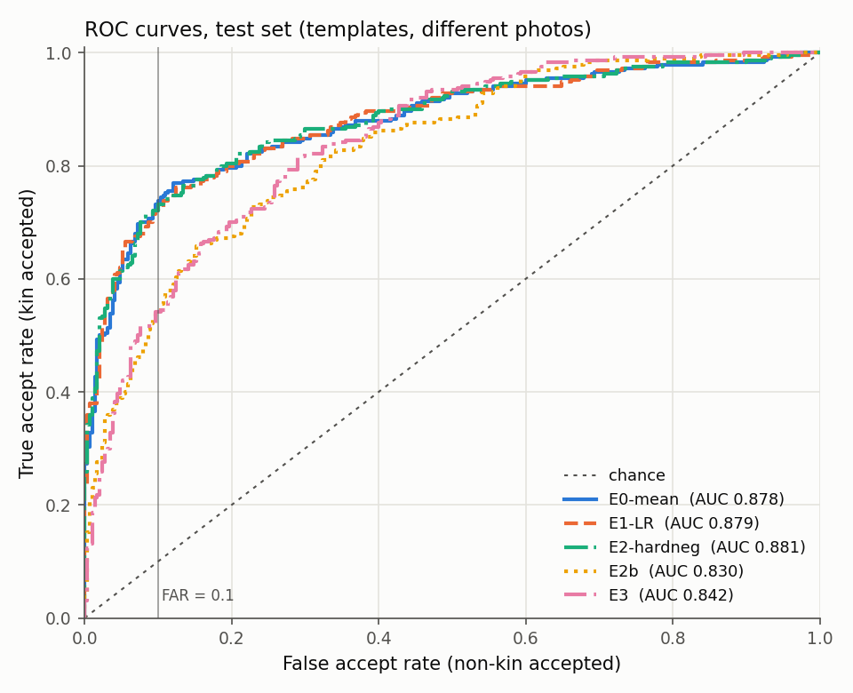
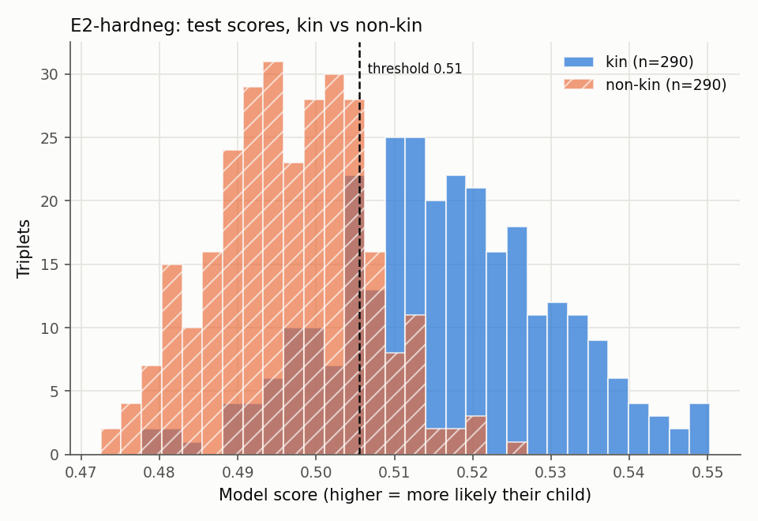
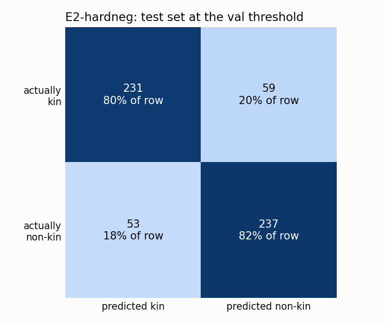
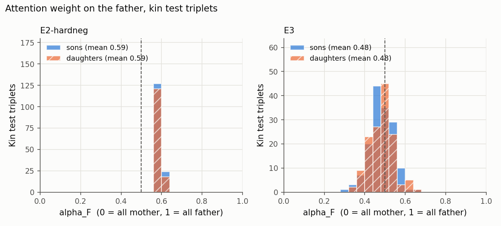

# Results

*Generated automatically by `scripts/make_report.py` on 2026-10-26 18:06 from `outputs/results/*.json`. Do not edit by hand.*

Dataset format: **fiw**, positive triplets from **matrix**.
- train: 686 families, 1434 positive triplets ({'FMS': 726, 'FMD': 708}), balanced set 2868, hard set 0, pairs 11832
- val: 147 families, 297 positive triplets ({'FMS': 157, 'FMD': 140}), balanced set 594, hard set 594, pairs 2548
- test: 147 families, 298 positive triplets ({'FMS': 155, 'FMD': 143}), balanced set 596, hard set 596, pairs 2422

Face detection: 26507/26517 images (100.0%); 10 centre-crop fallbacks; 475 with several faces.

## Tri-subject verification: main test set

**Headline protocol: per-person templates, parent and child compared only through images from different photos.** In FIW, relatives are often cut from the same photo, and same-photo faces look alike for non-kinship reasons (lighting, camera, colour). The *all photos* columns show the score when that shortcut is allowed.

Threshold chosen on validation only. Test set: 580 triplets, 50% kin / 50% non-kin; 16 rows were dropped because a parent and the child never appear in different photos.

| Exp | Description | Accuracy | ROC-AUC | F1 | TAR@FAR=0.1 | Acc (all photos) | AUC (all photos) |
|---|---|---|---|---|---|---|---|
| E0-max | frozen ArcFace, max of cos(F,C) and cos(M,C), no training | 0.786 | 0.867 | 0.765 | 0.648 | 0.834 | 0.917 |
| E0-max (facenet) | frozen FaceNet, max of cos(F,C) and cos(M,C), no training | 0.721 | 0.775 | 0.710 | 0.421 | 0.748 | 0.816 |
| E0-max (facenet_ft) | frozen fine-tuned FaceNet, max of cos(F,C) and cos(M,C), no training | 0.733 | 0.787 | 0.726 | 0.434 | 0.747 | 0.817 |
| E0-mean | frozen ArcFace, mean of cos(F,C) and cos(M,C), no training | 0.797 | 0.878 | 0.797 | 0.738 | 0.862 | 0.926 |
| E0-mean (facenet) | frozen FaceNet, mean of cos(F,C) and cos(M,C), no training | 0.721 | 0.796 | 0.734 | 0.469 | 0.767 | 0.841 |
| E0-mean (facenet_ft) | frozen fine-tuned FaceNet, mean of cos(F,C) and cos(M,C), no training | 0.729 | 0.809 | 0.752 | 0.510 | 0.777 | 0.843 |
| E1-LR | logistic regression on 8 hand-made features (frozen ArcFace) | 0.793 | 0.879 | 0.797 | 0.724 | 0.847 | 0.925 |
| E1-LR (facenet) | logistic regression on 8 hand-made features (frozen FaceNet) | 0.740 | 0.803 | 0.734 | 0.469 | 0.757 | 0.849 |
| E1-LR (facenet_ft) | logistic regression on 8 hand-made features (frozen fine-tuned FaceNet) | 0.721 | 0.814 | 0.749 | 0.531 | 0.767 | 0.848 |
| E1-SVM | linear SVM on 8 hand-made features (frozen ArcFace) | 0.795 | 0.880 | 0.798 | 0.724 | 0.849 | 0.926 |
| E1-SVM (facenet) | linear SVM on 8 hand-made features (frozen FaceNet) | 0.741 | 0.805 | 0.741 | 0.466 | 0.762 | 0.851 |
| E1-SVM (facenet_ft) | linear SVM on 8 hand-made features (frozen fine-tuned FaceNet) | 0.728 | 0.815 | 0.753 | 0.524 | 0.782 | 0.848 |
| E2 | attention-gated tri-subject head on frozen ArcFace | 0.807 | 0.871 | 0.793 | 0.679 | 0.846 | 0.919 |
| E2-hardneg | attention-gated tri-subject head on frozen ArcFace, 50% hard negatives in training | 0.807 | 0.881 | 0.805 | 0.731 | 0.859 | 0.928 |
| E2-pairs | attention-gated tri-subject head on frozen ArcFace, 50% hard negatives in training, comparator pretrained on pairs | 0.716 | 0.796 | 0.716 | 0.476 | 0.767 | 0.845 |
| E2b | attention-gated tri-subject head on frozen FaceNet | 0.736 | 0.830 | 0.720 | 0.538 | 0.780 | 0.863 |
| E3 | FaceNet fine-tuned end to end (block8, last_linear, last_bn unfrozen) with the tri-subject head, started from E2b | 0.747 | 0.842 | 0.730 | 0.541 | 0.789 | 0.872 |

## Breakdowns (test, different-photo protocol)

*Per-image*: one random photo per person instead of the average over all photos. *Hard*: negatives with one wrong parent (the child is real). 

| Exp | Acc (per-image) | AUC (per-image) | Acc (hard) | AUC (hard) | Acc FMS | Acc FMD | Val acc | Val AUC |
|---|---|---|---|---|---|---|---|---|
| E0-max | 0.747 | 0.817 | 0.597 | 0.621 | 0.791 | 0.781 | 0.820 | 0.898 |
| E0-max (facenet) | 0.693 | 0.763 | 0.588 | 0.604 | 0.728 | 0.712 | 0.723 | 0.786 |
| E0-max (facenet_ft) | 0.703 | 0.765 | 0.598 | 0.617 | 0.732 | 0.734 | 0.727 | 0.797 |
| E0-mean | 0.745 | 0.832 | 0.634 | 0.711 | 0.808 | 0.784 | 0.856 | 0.919 |
| E0-mean (facenet) | 0.681 | 0.765 | 0.614 | 0.673 | 0.719 | 0.723 | 0.725 | 0.785 |
| E0-mean (facenet_ft) | 0.697 | 0.770 | 0.598 | 0.687 | 0.735 | 0.723 | 0.727 | 0.788 |
| E1-LR | 0.736 | 0.827 | 0.628 | 0.705 | 0.815 | 0.770 | 0.858 | 0.918 |
| E1-LR (facenet) | 0.697 | 0.766 | 0.602 | 0.652 | 0.742 | 0.737 | 0.721 | 0.791 |
| E1-LR (facenet_ft) | 0.698 | 0.772 | 0.586 | 0.667 | 0.719 | 0.723 | 0.735 | 0.795 |
| E1-SVM | 0.734 | 0.827 | 0.633 | 0.705 | 0.815 | 0.773 | 0.860 | 0.918 |
| E1-SVM (facenet) | 0.688 | 0.767 | 0.598 | 0.646 | 0.752 | 0.730 | 0.727 | 0.789 |
| E1-SVM (facenet_ft) | 0.698 | 0.773 | 0.590 | 0.665 | 0.728 | 0.727 | 0.734 | 0.794 |
| E2 | 0.712 | 0.816 | 0.666 | 0.704 | 0.821 | 0.791 | 0.846 | 0.912 |
| E2-hardneg | 0.738 | 0.830 | 0.645 | 0.714 | 0.825 | 0.788 | 0.862 | 0.919 |
| E2-pairs | 0.676 | 0.738 | 0.583 | 0.663 | 0.732 | 0.698 | 0.780 | 0.836 |
| E2b | 0.710 | 0.798 | 0.647 | 0.709 | 0.748 | 0.723 | 0.734 | 0.803 |
| E3 | 0.722 | 0.814 | 0.650 | 0.709 | 0.755 | 0.737 | 0.742 | 0.815 |

## Pairwise parent-child verification: P0-cosine (facenet)

frozen FaceNet, cosine similarity of the pair. Templates; different-photo protocol unless marked *all photos*.

| Relation | n | Accuracy | ROC-AUC | AUC (all photos) |
|---|---|---|---|---|
| all | 2300 | 0.686 | 0.767 | 0.786 |
| FD | 320 | 0.641 | 0.750 | 0.761 |
| FS | 344 | 0.680 | 0.764 | 0.782 |
| MD | 324 | 0.707 | 0.780 | 0.804 |
| MS | 350 | 0.723 | 0.797 | 0.808 |
| related | 962 | 0.682 | 0.775 | 0.802 |

## Pairwise parent-child verification: P0-cosine (facenet_ft)

frozen fine-tuned FaceNet, cosine similarity of the pair. Templates; different-photo protocol unless marked *all photos*.

| Relation | n | Accuracy | ROC-AUC | AUC (all photos) |
|---|---|---|---|---|
| all | 2300 | 0.701 | 0.780 | 0.797 |
| FD | 320 | 0.684 | 0.760 | 0.767 |
| FS | 344 | 0.706 | 0.781 | 0.792 |
| MD | 324 | 0.710 | 0.787 | 0.809 |
| MS | 350 | 0.729 | 0.810 | 0.820 |
| related | 962 | 0.692 | 0.785 | 0.812 |

## Pairwise parent-child verification: P0-cosine

frozen ArcFace, cosine similarity of the pair. Templates; different-photo protocol unless marked *all photos*.

| Relation | n | Accuracy | ROC-AUC | AUC (all photos) |
|---|---|---|---|---|
| all | 2298 | 0.746 | 0.820 | 0.846 |
| FD | 320 | 0.691 | 0.773 | 0.800 |
| FS | 344 | 0.765 | 0.824 | 0.849 |
| MD | 324 | 0.784 | 0.865 | 0.883 |
| MS | 350 | 0.757 | 0.842 | 0.877 |
| related | 960 | 0.741 | 0.810 | 0.837 |

## Attention weights (kin test triplets)

Does alpha_F rise when the child is more similar to the father than to the mother (cos(F,C) - cos(M,C))? Only where it does can alpha be read as "resembles father X%".

| Exp | Spearman rho | p-value | alpha picks more similar parent | mean alpha_F | mean alpha_F (sons) | mean alpha_F (daughters) |
|---|---|---|---|---|---|---|
| E2 | -0.03 | 6.2e-01 | 40% | 0.54 | 0.54 | 0.54 |
| E2-hardneg | -0.05 | 4.2e-01 | 40% | 0.59 | 0.59 | 0.59 |
| E2-pairs | -0.46 | 1.0e-16 | 33% | 0.51 | 0.51 | 0.52 |
| E2b | +0.54 | 6.5e-23 | 71% | 0.46 | 0.46 | 0.46 |
| E3 | +0.52 | 1.3e-21 | 70% | 0.48 | 0.48 | 0.48 |

## Figures

 

**E2-hardneg, worst false positives (non-kin scored as kin):**

**E2-hardneg, worst false negatives (kin scored as non-kin):**

## Reference

Published RFIW tri-subject leaderboard accuracies are roughly 0.68-0.79. Our split and protocol differ, so they are a reference point, not a direct comparison.
